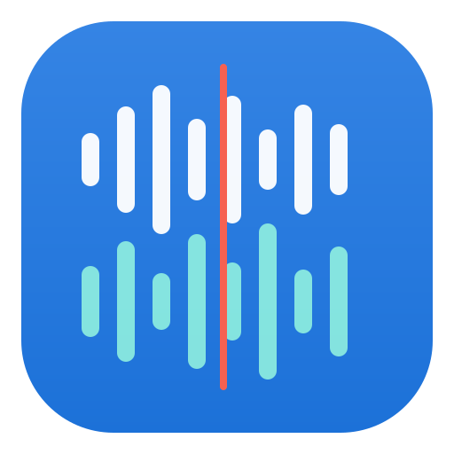
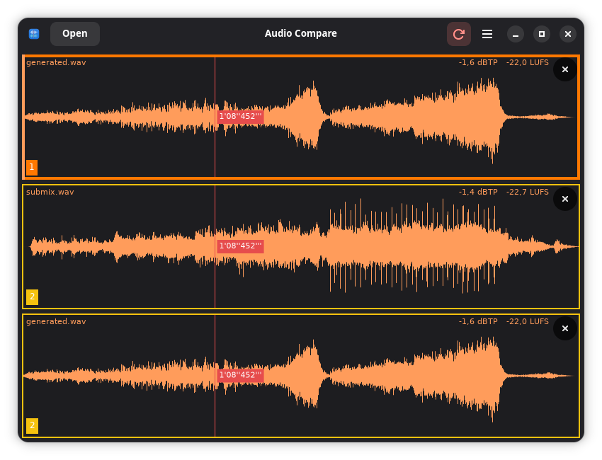

<p align="center"></p>

# audio-compare

Compare two or more audio files by ear on GNOME.

Load some files, see their waveforms stacked, and A/B them at the same playback position — switch which one you hear without losing your place.



## Features

- Open `mp3`, `wav`, `ogg` files (mono or stereo) via the Open button or drag-and-drop.
- One waveform pane per file, following the light/dark scheme and system accent colour.
- Switching keeps the playback position, so you always compare the same moment.
- Playback loops from the start on end.
- Each pane shows integrated loudness (LUFS) and max true peak (dBTP).
- Group tracks into **busses**: hover a track and press `0`–`9` to assign it.
  All tracks on the active bus play together, mixed and in sample-accurate sync,
  so you can A/B two busses. Busses are shown by a coloured border and a
  numbered badge; ungrouped tracks play on their own.
- Invert a track's polarity (×−1) to line it up against another for null tests;
  the waveform flips to show it.

| Shortcut | Action |
|---|---|
| `Space` | Play / pause |
| `Alt+↑` / `Alt+↓` | Switch to the file above / below (keeps position) |
| `←` / `→` | Seek ∓5 s (`Shift` ∓1 s, `Ctrl` ∓100 ms) |
| `0`–`9` (over a pane) | Assign the track to that bus (same key again unassigns) |
| `-` / `i` (over a pane) | Invert the track's polarity (×−1) |
| `m` (over a pane) | Mute / unmute the track |
| `s` (over a pane) | Solo the track within its bus |
| Click a pane | Switch to it, keeping the position |
| Click + drag | Scrub the active pane |

## Install

**Nix** (Linux and macOS, x86_64 and Apple Silicon)
```sh
nix run github:mmxgn/audio-compare
```

**AppImage** (Linux) — grab the latest from the [releases page](https://github.com/mmxgn/audio-compare/releases/latest).
```sh
chmod +x audio-compare-*.AppImage && ./audio-compare-*.AppImage
```

### macOS

The app runs natively on macOS (GTK's macOS backend, audio through Core Audio).
There is no `.app` bundle yet, so it is launched from a terminal.

**With Nix** — install [Nix](https://nixos.org/download/) with flakes enabled, then:
```sh
nix run github:mmxgn/audio-compare
```

**With Homebrew** — build from a checkout:
```sh
brew install meson ninja pkg-config gtk4 libadwaita gstreamer libebur128
meson setup build && ninja -C build && ./build/audio-compare
```

Notes:
- `Alt` in the shortcuts table is the `Option` (⌥) key, so switching files is `⌥↑` / `⌥↓`.
- The first launch after installing GStreamer prints plugin-scanner warnings
  (`gi.repository.Gst`, duplicate `objc` classes) while GStreamer builds its
  plugin cache. They are harmless and do not reappear.

## Develop

```sh
nix develop
meson setup build && ninja -C build && ./build/audio-compare
```

The dev shell works the same on Linux and macOS (it uses gcc on Linux, clang on macOS).

## Requirements

GTK 4 · libadwaita · GStreamer · libebur128
